# 知识库梳理报告（2026-11-12）

> 对象：`E:\llm_wiki\ai-wiki`（llm-wiki 结构）
> 方法：`scan-wiki.sh` 结构扫描 + `lint-wiki.sh` 交叉校验 + 元数据/计数/重复页核对；只读检查，未改动知识库内容
> 说明：`stock-wiki` 是另一个独立库，本报告未覆盖，需要时另行梳理

## 1. 总览

**定位**：以 AI 工具、AI 编程与 Agent 为核心的个人知识库——49 篇素材沉淀出 42 个实体、7 个主题和 4 篇综合，近一周新增集中在 AI Agent 工具链（GIF 工厂、OmniGet、DeskBox、PixelFX、《深入理解 AI Agent》）。

| 项目 | 数量 |
|---|---|
| 素材摘要（wiki/sources） | 49 |
| 实体页（wiki/entities） | 42 |
| 主题页（wiki/topics） | 7 |
| 综合分析（wiki/synthesis） | 4 |
| Wiki 页面合计 | 102 |
| 全库 Markdown + 资源文件 | 161 |
| raw 素材 | 59 篇 Markdown（articles 37 / tweets 18 / notes 3 / xiaohongshu 1）+ 图片与 JSON 资源 |
| 断链 | 0（修复前 10，其中 1 真 9 误报） |
| 孤页 | 0（修复前 2） |
| 占位/过短 | 0（修复前 9，其中 5 需补） |
| **元数据** | **source_path 49/49 有效（修复前 44 失效）** |
| 工具链 | `scan-wiki.sh` 已修：递归统计 sources、图片参与链接解析、按引用判断未消化 |

**一句话结论**：内容本身健康（无重复页、无真实缺页、计数自洽）。报告初稿发现的两类「结构性欠账」——source_path 元数据大面积失效、自有工具脚本没跟上 sources 目录重构——**已于 2026-11-12 修复**，修复后扫描为 0 断链 / 0 孤页 / 0 未消化 / 0 占位。

## 2. 主题地图

```mermaid
graph TD
  A[AI编程开发] --> A1[DeepSeek Harness]
  A --> A2[Claude Code]
  A --> A3[Cursor]
  A --> A4[MCP 模型上下文协议]
  A --> A5[RAG 知识库]
  A --> A6[AI Agent 智能体]
  B[AI内容创作] --> B1[DeepSeek]
  B --> B2[DeepSeek Agent]
  B --> B3[豆包]
  C[AI创意设计] --> C1[DeepSeek]
  C --> C2[Looseleaf]
  D[AI办公自动化] --> D1[DeepSeek]
  D --> D2[语雀 AI]
  E[工具集] --> E1[OmniGet]
  E --> E2[DeskBox]
  E --> E3[GIF 工厂]
  E --> E4[PixelFX]
  F[Claude Code 实战开发术] --> F1[Claude Code]
  G[鱼皮 AI 指南] --> G1[通义灵码]
  G --> G2[Ollama]
```

## 3. 分主题要点

### AI 编程开发（内容最厚）

- 核心主张是「多工具组合协作」与「迭代开发优先」，未来程序员更像 AI 操控师。来源：[[AI编程开发]]
- 概念层覆盖 16 个关键术语（大模型、Token、RAG、Embedding、ReAct、MCP 等），并给出 RAG 标准工作流。来源：[[AI编程开发]]
- 这一主题聚合了最多的实体：[[DeepSeek Harness]]、[[Claude Code]]、[[Cursor]]、[[MCP 模型上下文协议]]、[[RAG 知识库]]。

### AI 内容创作

- 效率提升有具体数据：熟练使用 AI 的创作者日均有效字数提升 3–5 倍、签约通过率提高 60%。来源：[[AI内容创作]]
- 方法论核心是「结构化提示词 + 人机协同」：AI 负责框架与机械劳动，人负责情感与原创。来源：[[AI内容创作]]
- 涉及实体：[[DeepSeek]]、[[DeepSeek Agent]]。

### AI 创意设计

- 成熟模式是「大脑 + 执行端」：DeepSeek 出策略/脚本/提示词，专业工具负责渲染。来源：[[AI创意设计]]
- 国产工具链已能闭环：大模型 → 生图 → 视频 → 剪辑 → 3D。来源：[[AI创意设计]]
- 与 [[Looseleaf]]（前端组件）、[[DeepSeek]] 相关联。

### AI 办公自动化

- 关键判断：把 AI 嵌进 Excel/Word 才叫效率革命，VBA + API 是当下最可行的落地方案。来源：[[AI办公自动化]]
- 出现「AI 自增强循环」：DeepSeek 生成 VBA 增强自身在 Office 中的能力。来源：[[AI办公自动化]]

### Claude Code 实战开发术

- 七条实战术的核心是「验证转移 + 证据优先 + 独立评审 + 循环限流 + 不可逆人工确认 + 可回滚」。来源：[[Claude Code 实战开发术]]
- 与实体 [[Claude Code]] 强绑定，是「工程纪律」类主题。

### 工具集（最新）

- 按七类整理已记录工具：下载与媒体、AI 编程、Agent 框架、知识库、自动化、设计、桌面效率。来源：[[工具集]]
- 最近三条：[[OmniGet]]（whisper + MCP）、[[DeskBox]]（Windows 桌面整理）、[[PixelFX]]（像素特效 + Claude Code Skill）。

### 鱼皮 AI 指南

- 面向程序员的 AI 知识体系：工具链、编程技巧与核心概念。来源：[[鱼皮 AI 指南]]
- 相关实体：[[通义灵码]]、[[Ollama]]、[[Cursor]]。

## 4. 素材覆盖

| raw 分类 | 文件数 | 消化状态 |
|---|---|---|
| `raw/articles` | 37 | 均有对应摘要页（按标题核对） |
| `raw/tweets` | 18 | 均有对应摘要页 |
| `raw/notes` | 3 | 均有对应摘要页 |
| `raw/xiaohongshu` | 1 | 有对应摘要页 |
| `raw/**/assets`、`*.json` | 若干 | 图片/数据资源，不算待消化 |

**未发现未消化的 Markdown 素材。** 但要注意：由于 source_path 元数据失效（见第 5 节），「已消化」目前只能按标题人工核对，无法用脚本自动验证——这是本次最需要修的地方。

## 5. 健康检查

### 5.1 断链（10 条，真正需修 1 条）

- **真断链（1）**：「这本书能让你连接互联网-tweet」双链 ← `wiki/sources/learning/这本书能让你连接互联网.md`。原始推文在 `raw/tweets/2026-11-02-fq-book-tweet.md`，但 wiki 中没有同名页面。
- **误报（9）**：
  - 7 个图片嵌入（2026-11-02-*.webp）：文件实际存在于 `notes/assets/` 与 `raw/tweets/assets/`，Obsidian 按文件名全库解析可正常显示；scan 脚本只在固定目录找同名文件，故误报。
  - 2 个「链接」示例双链：位于 [[wiki-summarize 知识库梳理技能]] 与对应摘要页，是文档里描述双链语法的示例文字，不是真链接；建议改成行内代码避免歧义。
- **影响**：Obsidian 里只有 1 处真的点不开；其余不影响阅读。

### 5.2 孤页（2 条）

- `wiki/overview.md`：没有其他页面用 `[[overview]]` 引用它（index 用的是普通链接）。影响小，可接受；可在 index 顶部补一个 `[[overview]]` 入口。
- `wiki/synthesis/2026-04-29-deepseek-content-creation-deep-dive.md`：无入链。影响：这篇综合分析很难被顺链发现，建议在 [[AI内容创作]] 或 index 里补引用。

### 5.3 占位/过短（9 条，真正需补 5 条）

- **真需补（5）**：`wiki/sources/ai-content/` 下 5 篇摘要含 `（待补充）`——[[DeepSeek 内容创作指南]]、[[DeepSeek 长篇小说协作]]、[[公文新闻广告写作技巧]]、[[小红书爆款写作公式]]、[[网文创作完整教程]]。影响：这 5 篇的「实操内容保留」或关联信息不完整。
- **误报（4）**：[[wiki-summarize 知识库梳理技能]]（两处）与 `notes/本机技能与代理清单.md` 是文档在描述「占位文本检查」这个功能；`raw/articles/2026-11-12-deskbox-readme.md` 是 README 里出现 placeholder 相关词。

### 5.4 元数据失效（最严重）

- **44/49 篇 source_path 指向不存在的 raw 路径**：目录重构时 source 页文件名改成了标题优先，但 `source_path` 仍指向旧的中文文件名（如 `raw/articles/网文创作完整教程.md`），实际 raw 是日期-slug（`2026-04-29-deepseek-novel-tutorial.md`）。
- **影响**：① 无法用脚本自动核对「素材是否已消化」；② 想回看原文时路径点不开；③ 扫描报告把 raw 误判为未消化。
- **只有 5 篇是准确的**：均为 2026-11-11 之后新建的页面（GIF 工厂、OmniGet、DeskBox、PixelFX、《深入理解 AI Agent》）。

### 5.5 工具链问题

- `scan-wiki.sh` 统计 `wiki/sources` 用的是 `maxdepth 1`，目录重构后显示 **0 页**，并把 raw 里的图片/json 误列为「疑似未消化」。
- `lint-wiki.sh` 已在迁移时改为递归，**两者不一致**；按 skill 约定以 scan 为准，但当前 scan 的 sources 统计不可信。
- **影响**：以后每次「梳理知识库」都会误报，需要先修脚本。

### 5.6 计数一致性

- index：49 素材 / 102 页面，与实际一致 ✅
- overview：49 素材 / 42 实体，与实际一致 ✅
- 未发现重复标题、重复实体页。

## 5.7 修复记录（2026-11-12）

- **source_path**：用 git rename 历史还原「旧 date-slug → 新标题」映射，43 篇按 raw 文件自动回填，1 篇指向技能文档，最终 49/49 有效。
- **scan-wiki.sh**：sources 统计改为递归；非 md 文件（图片等）参与链接解析；未消化检测改为「raw 路径是否被 wiki 页引用」；占位检查限定 wiki 页并去掉「占位」关键词。
- **5 篇 ai-content 摘要**：把「（待补充）」换成 [[AI内容创作]] 等真实关联页。
- **断链**：修复「这本书能让你连接互联网」的推文引用；wiki-summarize 文档里的示例双链改成普通文字。
- **孤页**：index 增加 [[overview]] 入口；[[AI内容创作]] 补综合分析入链。

## 6. 待补全建议

1. ~~批量修复 source_path~~（已修复：按 git rename 历史回填，49/49 有效）。
2. ~~修 `scan-wiki.sh`~~（已修复：sources 递归统计、图片参与链接解析、未消化按引用判定）。
3. ~~补 5 篇 ai-content 摘要~~（已修复：换成真实关联页链接）。
4. ~~修 1 条真断链~~（已修复：改为 raw 推文路径；示例双链改普通文字）。
5. ~~给孤页补入链~~（已修复：index 增加 overview 入口，AI内容创作补综合分析入链）。

---

_报告由 wiki-summarize 流程生成（2026-11-12）；未提交、未推送，内容未做任何改动。_
