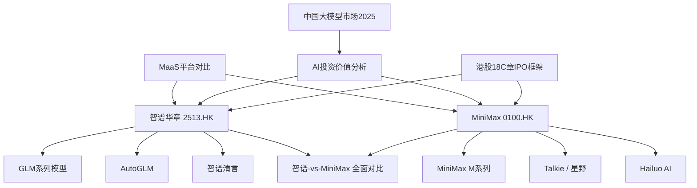

# 知识库梳理报告（2026-11-01）

## 1. 总览

**Stock AI IPO Wiki** —— 聚焦智谱华章（2513.HK）与 MiniMax（0100.HK）两家以港股 18C 章上市的 AI 大模型公司的 IPO 知识库，数据截止 2025 年三季度。

| 项目 | 数量 |
|---|---|
| 实体页 entities | 9 |
| 主题页 topics | 3 |
| 素材摘要 sources | 2 |
| 对比页 comparisons | 1 |
| 综合页 synthesis | 7 |
| 索引 index | 1 |
| **页面合计** | **23** |
| 发现问题 | 断链 7 · 孤页 6 · 占位文本 2 · 结构缺失 3 |

## 2. 主题地图

## 3. 分主题要点

### 3.1 两家公司本体

- 智谱华章 2019 年 6 月由清华系团队创立，2024 年收入 RMB 3.12 亿，在独立大模型厂商中排名第一、全行业第二（份额 6.6%），IPO 定价 HK$116.20，2026-01-08 上市。[[智谱华章]]
- 智谱收入结构以本地化部署为主（H1 2025 占 84.8%），云端仅 15.2%，客户为大型企业与政府机构。[[智谱华章]]
- MiniMax 2021 年 12 月由前商汤 VP 闫俊杰创立，累计用户 2.12 亿、覆盖 200+ 国家，2024 年收入 USD 3,052 万，按 18C 章「未商业化」路径上市。[[MiniMax]]
- MiniMax 收入由 C 端 AI 原生产品贡献约 71%（Talkie 35.1% + Hailuo 32.6%），开放平台与企业服务仅约 29%。[[MiniMax]]
- 治理结构差异明显：智谱为 H 股架构、靠一致行动协议维持约 30.22% 控制权；MiniMax 用 WAB 同股不同权，创始人以 25.36% 经济权益掌握 72.05% 投票权。[[智谱华章]] [[MiniMax]]

### 3.2 模型能力

- GLM 系列覆盖语言、多模态、Agent、代码四类；GLM-4.5 为中国第一、全球第三，GLM-4.6 在 CodeArena 全球第一。[[GLM系列模型]]
- GLM 框架是中国首个自研预训练大模型框架（2021），采用 MoE + 稀疏激活，支持 1.5B–230B 参数与 40+ 芯片平台。[[GLM系列模型]]
- MiniMax M 系列采用 MoE + Lightning Attention，M1 支持 100 万 token 上下文并开源，M2 专攻代码与 Agent，Intelligence Index 全球第 5。[[MiniMax M系列]]
- 两家是「互补而非直接竞争」：智谱强在代码与 B 端部署，MiniMax 强在视频（Hailuo-02 全球第 2）与语音（Speech-02 全球第 1）。[[MiniMax M系列]] [[GLM系列模型]]

### 3.3 产品与商业模式

- AutoGLM 主打「从对话到执行」，2.0 版本支持云端异步执行，Rumination 版本实现「边思考边执行」。[[AutoGLM]]
- 智谱清言是 C 端入口，首批通过监管备案，但在收入上主要由 B 端 MaaS 变现，C 端更多承担生态与数据积累。[[智谱清言]]
- Talkie/星野是 MiniMax 第一大收入来源（9M 2025 USD 1,875 万，占 35.1%），曾因内容审核在部分市场 App Store 下架约两个月。[[Talkie]]
- Hailuo AI 收入贡献第二（9M 2025 USD 1,746 万，占 32.6%），Hailuo-02 排名全球第 2，仅次于字节 Seedance 1.0。[[Hailuo AI]]
- MaaS 层面，智谱以本地化项目制交付为主、MiniMax 以云端 API 按量计费为主，客户画像从大企业/政府到开发者/中小企业完全分化。[[MaaS平台对比]]

### 3.4 行业环境与估值

- 中国 LLM 市场 2024 年 RMB 53 亿，2030 年预计 1,011 亿，CAGR 63.5%；企业端本地化部署占比超 80%，是中国市场区别于全球的显著特征。[[中国大模型市场2025]]
- 独立厂商与非独立厂商（BAT 等）分化明显：前者靠技术差异化与开源生态，后者靠生态绑定与流量入口。[[中国大模型市场2025]]
- 18C 章的关键分水岭是 RMB 2.5 亿收入门槛，智谱达标走「已商业化」，MiniMax 未达标走「未商业化」并需满足研发占比 ≥60%。[[港股18C章IPO框架]]
- 估值处于极高水平：智谱 PS 约 153x、MiniMax 约 200–220x，远超传统 SaaS 的 10–30x，反映 AGI 叙事溢价。[[AI投资价值分析]]
- 生存能力是核心变量：智谱现金跑道 27.3 个月、MiniMax 含 IPO 后 54 个月；智谱毛利率从 64.6% 降至 50.0%，MiniMax 从 -24.7% 转正至 23.3%，方向相反。[[AI投资价值分析]]

## 4. 素材覆盖

本库**没有 `raw/` 目录**，因此无法核验素材消化状态（scan 输出 `raw/: 不存在`）。

现有素材入口只有两页结构化摘要：

| 素材 | 摘要页 | 状态 |
|---|---|---|
| 智谱华章招股书（2025-12-30） | [[zhipu-ai-ipo-20251230]] | 已消化 |
| MiniMax 招股书（2025-12-31） | [[minimax-ipo-20251231]] | 已消化 |

> `.wiki-schema.md` 的目录结构中声明了 `raw/`（招股书 PDF 转 Markdown），但实际不存在。招股书原文不在库内，报告中的数字只能追溯到 sources 摘要页，无法回溯原文。

## 5. 健康检查

### 5.1 断链（7 处）

| 悬空链接 | 所在页面 |
|---|---|
| `傅宇玉`、`闫俊杰` | wiki/entities/MiniMax.md |
| `刘德兵`、`张鹏`、`李涓子`、`君联资本`、`美团` | wiki/entities/智谱华章.md |

影响：这 7 个链接全部指向**人物页和投资方页**——这类实体页从未创建。在 Obsidian 中点击会落空，图谱里也看不到创始人/股东节点。

### 5.2 孤页（6 处）

全部是 `wiki/synthesis/` 下的深度分析长文：

- 智谱vs-MiniMax投资深度对比
- 智谱vs-MiniMax国资投资对比分析
- 智谱vs-MiniMax外资投资对比分析
- 智谱vs-MiniMax投资额度总排名分析
- 智谱vs-MiniMax投资风险综合分析
- 智谱vs-MiniMax高管团队对比分析

**根因**：`index.md` 的「深度分析文章」表格用的是纯文本标题，没有写成双链形式，所以这 6 篇约 13 万字的分析没有任何入链，从索引点不进去，只能靠搜索。

### 5.3 占位文本（2 处）

- `wiki/synthesis/智谱vs-MiniMax投资额度总排名分析.md`
- `wiki/synthesis/智谱vs-MiniMax高管团队对比分析.md`

影响：命中 TODO/待补充/占位 等关键词，需人工确认是真实未完成内容还是误报。

### 5.4 结构缺失（3 处）

| 项 | 状态 | 影响 |
|---|---|---|
| `raw/` | 不存在 | 素材无法回溯原文 |
| `log.md` | 缺失 | 无法追溯知识库的演进历史 |
| `wiki/overview.md` | 缺失 | 缺少全局导航页（本报告第 2 节可部分替代） |

## 6. 待补全建议

1. **建 5 个人物实体页**（刘德兵、张鹏、李涓子、闫俊杰、傅宇玉）——一次消除 7 个断链中的 5 个，且高管对比分析长文已有现成素材。
2. **建 2 个投资方实体页**（君联资本、美团）——消除剩余 2 个断链；若扩展到 ADIA、阿里、米哈游等基石投资者，可与投资类长文互链。
3. **把 `index.md` 的「深度分析文章」表格改成双链形式**——一次性消除 6 个孤页，这是投入产出比最高的一处修改。
4. **补 `log.md` 与 `wiki/overview.md`**——仓库 `AGENTS.md` 要求每次消化后同步更新这两个文件，当前均缺失。
5. **补齐 `raw/` 或修正 schema**——要么把招股书原文放进来，要么把 `.wiki-schema.md` 里的 `raw/` 声明删掉，避免规范与现状不符。
